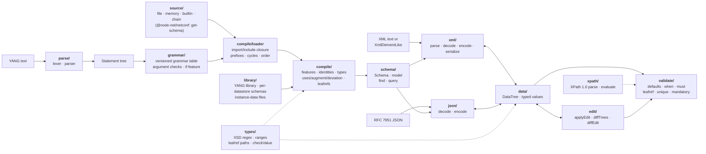

# @node-net/yang: design

Status: living document, revision 2, 2026-11-10. It describes @node-net/yang as built through milestone M6. Sections 5 to 9 cover the parser, compiler and codecs in depth; the decisions behind M4 (server schemas), M5 (validation) and M6 (edits and diffs) are recorded in [rfcs.md](./rfcs.md), and summarised here in §3, §10 and §13.

Companion document: [rfcs.md](./rfcs.md), the survey of all 165 YANG-related RFCs, with their importance tiers and the milestone plan. This document covers *how* @node-net/yang is built. rfcs.md covers *what* it implements and why.

## 1. Why build it

In November 2026 npm had no maintained, complete YANG implementation:

- **yang-js** (corenova) is the most complete, but has had no release since May 2024. It is CoffeeScript-derived CJS with no types, and built around its own data-binding model.
- **yang-parser** (Lhotka) and its forks only parse syntax: they produce a statement tree and resolve nothing.
- **libyang** on npm is a 2017 native binding to libyang 0.x. The real libyang (3.x, C) is excellent and active, but has no current Node binding.
- Everything else is dead, editor tooling, or shells out to pyang or libyang.

We chose to write it in TypeScript rather than bind libyang natively or compile it to WASM. Writing the syntax parser is cheap. The real work is the compiler and the codecs, and with AI assistance, a large external corpus and two independent oracles (pyang and yanglint), building them is feasible and gives a dependency-free, pure-ESM package.

YANG is used well beyond NETCONF: RESTCONF, gNMI with OpenConfig models, CORECONF, offline config generation and linting. So @node-net/yang is its own package, not part of @node-net/netconf.

## 2. Goals and non-goals

**Goals**

- **Correct against the RFCs:** RFC 7950 and RFC 6020 for the language, RFC 7951 and the YANG XML rules for data, RFC 7952 for metadata. The tiers and milestones are in rfcs.md.
- **Protocol-agnostic.** @node-net/yang never depends on @node-net/netconf; a lint rule forbids the import. NETCONF (and later RESTCONF or gNMI) plug in through small interfaces: module sources, parsed-XML shapes, namespace mappings (§10).
- **Pure TypeScript.** No native bindings, no WASM, no Python or C at runtime. One runtime dependency: `@rgrove/parse-xml`, shared with @node-net/netconf (§8.5).
- **Problems are data.** Problems in modules and in instance data come back as diagnostics or typed errors, with locations or data paths, and a stable code. Only input that can't be read at all throws.
- **Configuration over code.** The YANG grammar is a data table. Device- and model-specific knowledge lives in data files (bundled modules, profiles), not in branches of code.
- **Modern packaging:** ESM-only, loadable with `require()` from CommonJS (no top-level await), Node.js 22.12 or later, strict TypeScript.

**Non-goals**

- Protocol work: fetching modules, parsing `<hello>`, talking to devices. That belongs to @node-net/netconf and future sibling packages.
- Enforcing NACM, mapping YANG to DSDL (RFC 6110), translating SMIv2 to YANG (RFC 6643), and YANG language abstractions (RFC 6095).
- Generating TypeScript types from YANG. That could be a later tool on top of the compiled schema.

## 3. Architecture

@node-net/yang is a pipeline. Each stage has its own directory and consumes only the stages before it.



| Directory | Contents | Milestone |
|-----------|----------|-----------|
| `src/parse/` | Lexer, statement parser, `parseModule()`, the `Statement` type; YIN input (M4) | M1, M4 |
| `src/grammar/` | The statement grammar as data, the grammar checker, argument syntax, `if-feature` expressions | M1 |
| `src/source/` | `ModuleSource` and the built-in sources | M2 |
| `src/compile/` | Loader, compile context (scopes, features, identities, extensions), type resolver, tree builder, `compileSchema()` | M2 |
| `src/schema/` | The compiled-schema model (the public contract), `Schema`, schema queries for completion, tree diagrams (M4) | M2, M3, M4 |
| `src/types/` | XSD regex translation and linear-time matching, range and length parsing, leafref path parsing, `checkValue()` | M2 |
| `src/data/` | The instance-data tree, typed values, lexical forms, instance-identifiers, anydata conversion, shared decode checks; with-defaults (M4) | M3, M4 |
| `src/xml/` | XML parsing (hardened), decoding to and encoding from the tree, serialising | M3 |
| `src/json/` | RFC 7951 decoding and encoding | M3 |
| `src/convert.ts` | `xmlToJson()` and `jsonToXml()` in one call | M3 |
| `src/library/` | YANG library input (RFC 8525, 7895, hello capabilities), per-datastore schemas, `yangLibraryData`, instance-data files (RFC 9195) | M4 |
| `src/xpath/` | XPath 1.0 parser, printer, compile-time checks and evaluator, with the YANG function library | M5 |
| `src/validate/` | Defaults and `when` before validation; `must`, leafref and instance-identifier integrity, `unique`, element counts, `mandatory`, choices | M5 |
| `src/edit/` | The edit engine (`applyEdit`, `tryApplyEdit`), tree copies, the diff (`diffTrees`, `diffEdit`, `editFromChanges`) | M6 |
| `src/errors.ts`, `src/location.ts` | `NetYangError`, `YangSyntaxError`, `YangDataError`; source locations and diagnostics | all |
| `modules/` | Bundled IETF modules (§6.1) | M2 |

The public API is everything exported from `src/index.ts`, and nothing else.

## 4. Cross-cutting principles

### 4.1 Diagnostics, not exceptions

There are three outcomes, and each API documents which it uses:

| Situation | Outcome | Example |
|-----------|---------|---------|
| The text can't be read as YANG statements at all | `YangSyntaxError` with `file:line:col` | unterminated string, missing `}`, invalid UTF-8 |
| A module is readable but wrong | `Diagnostic` (`severity`, stable `code`, `message`, `location`) in a list, and processing continues | unknown statement, bad cardinality, unknown type, augment target not found |
| Instance data is wrong | One `YangDataError` holding every `DataIssue` (`code`, `message`, RFC 7951 data path, and the line and column with the `positions` option) | unknown node, invalid value, missing list key |

One exception: `tryApplyEdit` returns an edit's errors with its result (`{ tree, errors, rejected }`) rather than throwing them, because under `stop-on-error` and `continue-on-error` part of the edit applies and the caller needs both. `applyEdit` throws as the table says.

The rule behind this: a tool such as nnc, an editor or a linter needs the whole statement tree and every problem at once, not the first one. `compileSchema()` never throws for module problems. It returns a `Schema` whose `diagnostics` (and `errors`) say what is wrong, and a schema with errors is still usable where it isn't affected. A grouping instantiated many times reports each problem once (diagnostics are de-duplicated by code, message and location).

### 4.2 Grammar as data

The substatement tables of RFC 7950 §7 and RFC 6020 §7 live in `src/grammar/statements.ts` as a table: each statement's argument kind, the first version it exists in, and its allowed substatements with cardinality. Where the versions differ, an entry gives both (`{ '1': '0..1', '1.1': '0..n' }`, or `null` for "not allowed in 1.0"). Module section order (header, linkage, meta, revision, body) is data too. YANG 2.0 (draft-ietf-netmod-yang2) should need new table entries, not new code.

### 4.3 The protocol boundary

@node-net/yang knows nothing of NETCONF, but it is shaped so that @node-net/netconf (and future RESTCONF or gNMI packages) can use it without glue:

- **Module sources** are anything with `load(name, revision?)`, so `<get-schema>` is just another source.
- **Parsed XML** is a structural interface, `XmlElementLike`, which @node-net/netconf's `XmlElement` already satisfies, so parsed trees cross the boundary without being serialised (§8.5).
- **Unknown attributes** (`nc:operation`, `wd:default`) pass through as text annotations. Callers map namespaces that belong to no YANG module with the `namespaces` option (namespace URI → module name).
- **Operations** can be decoded from bare parameters (a NETCONF `<rpc-reply>`) by naming the operation with the `operation` option. With type `notification` it names a notification (`/module:name`, or a nested one's parent instance followed by its name), whose bare content is then read.

### 4.4 Security

- XML: any DOCTYPE is rejected (no entity expansion, no external entities). Element depth is limited (256 by default) and so is node count (5 million by default).
- YANG text: statement nesting is limited to 500, so hostile input can't exhaust the stack. Characters outside RFC 7950's `yang-char` set are diagnosed.
- No `eval` or `Function`. Character classes in patterns become `RegExp` objects through a translator that emits only escaped, validated syntax (§7.4).
- Patterns run on values that come from devices or users, so they aren't matched by JavaScript's backtracking engine, which takes exponential time on some patterns. Nokia SR OS's `([^%]+|%[nsStTcC%])+` took 2 s on a 29-character value, doubling with each character. @node-net/yang's own matcher takes time linear in the value's length for every pattern (§7.4). A pattern whose automaton would need more than `MAX_PATTERN_SIZE` (100,000) instructions is rejected as invalid. That happens only with huge counted repeats: the largest in the corpus needs about 8,000.

## 5. Parsing (M1)

### 5.1 Lexer

The lexer follows RFC 7950 §6.1 and §14. Its tokens are unquoted strings, quoted strings, `+` (only directly after a quoted string), `;`, `{` and `}`. Whitespace and comments separate tokens.

- **Double-quoted strings** (§6.1.3): whitespace before a line break is removed. On each following line, indentation is removed up to and including the column of the opening quote. A tab examined for removal counts as 8 columns, and any part of it beyond the limit is kept as spaces. Only then are escapes replaced, so whitespace produced by `\t` or `\n` is never trimmed.
- **Interpretation:** the RFC doesn't say how to count a tab *before* the opening quote. We count it as 8 columns too, as libyang does. pyang counts both cases differently, and that is the only way our parse of the corpus differs from pyang's: about a dozen strings in modules indented with a mix of tabs and spaces.
- **Single-quoted strings** are literal, apart from CRLF being normalised to LF.
- **Concatenation:** each part is processed on its own, then joined.

### 5.2 Version-dependent lexical rules

Some lexical rules differ between YANG versions, but the version is only known once `yang-version` has been parsed. So the lexer records *lexical notes*, and the grammar check turns them into diagnostics at the severity the module's version calls for:

- an escape other than `\n`, `\t`, `\"` or `\\`: an error in YANG 1.1, a warning in 1.0 (RFC 6020 left it undefined, and old IETF modules use `\S` and `\*`)
- a quote character inside an unquoted string: an error
- a character outside `yang-char`: an error

### 5.3 Statement tree

A `Statement` has a keyword (`prefix:name` for an extension), an optional resolved argument, its substatements in source order, and the locations of its keyword and argument. Columns count UTF-16 code units, 1-based, as editors and LSP do. Extension statements and everything inside them are kept but not grammar-checked, since the extension defines their grammar.

`parseModule()` requires exactly one `module` or `submodule` per text, decodes UTF-8 strictly, and drops a byte-order mark.

## 6. Compilation (M2)

### 6.1 Module sources and bundled modules

```ts
interface ModuleSource {
  load(name: string, revision?: string): Promise<ModuleText | undefined>;
}
```

| Source | Behaviour |
|--------|-----------|
| `fileSource(dirs)` | `name.yang` and `name@revision.yang` (RFC 7950 §5.2), first directory with a match wins; the latest revision by default. A `name.yang` without a date is parsed to learn its revision. |
| `memorySource(texts)` | Each text is parsed once to learn its name and latest revision. A text that won't parse is still found by name, so the compiler can report its syntax error. |
| `chainSources(...)` | Tries each source in turn. |
| `builtinSource` | 15 bundled IETF modules: common types (three revisions each of `ietf-yang-types` and `ietf-inet-types`), metadata, structure extensions, datastores, origin, YANG library, RESTCONF, NACM, NETCONF and with-defaults. They are copied unchanged from the RFCs into `modules/`, under the IETF Trust's Simplified BSD licence for code components. |

Sources are asynchronous because some are remote. Compilation proper is synchronous.

### 6.2 Loading

Loading has two passes. The first fetches and parses the whole import/include closure, a batch at a time, in parallel. The second links it, synchronously:

- a prefix map per file (a submodule has its own imports, and uses its `belongs-to` prefix for its module)
- `belongs-to` checks, duplicate prefixes, self-imports
- includes of a submodule of the other YANG version, which RFC 7950 §12 forbids: a warning (`include-version-mismatch`), as libyang accepts them (pyang doesn't)
- import cycles (RFC 7950 §7.1.5)
- a dependency order: every module after the modules it imports

Requested modules are **implemented**. Modules that are only imported provide definitions (types, groupings, identities, features, extensions) but no nodes. **Several revisions of a module** can be in one set (since M4): one primary revision, the implemented one or else the latest requested, and secondary ones loaded because an import names them with `revision-date`. Secondary revisions are never implemented, and an import without a revision date gets the primary one. When a source lacks the revision an import names, the primary one is used with a `revision-mismatch` warning.

### 6.3 Compile phases

1. Module records, features, identities and extensions, for every loaded module.
2. Data trees of implemented modules, with groupings expanded in place and disabled `if-feature`s removed.
3. Top-level augments, retried until none applies, since one augment can target a node another one adds.
4. Deviations from implemented modules.
5. Finishing: list keys, `unique`, choice defaults, leafref targets, default values, and the checks on mandatory nodes.

Phases 2 and 3 repeat until the set of implemented modules stops growing (§6.5).

Mandatory nodes (RFC 7950 §3) are checked in phase 5, once refines and deviations have had their say, as libyang checks them (pyang checks before deviations). Two rules use them. A choice's default case must have none directly under it (§7.9.3): a container without `presence` counts if it holds one, and a nested choice only if it is itself mandatory (`mandatory-in-default-case`). An augment of a node in another module must not add mandatory configuration nodes (§7.17; a submodule counts as its module). A new case of a choice isn't a mandatory node, and state data, input, output and notifications aren't checked, as in libyang and pyang. A YANG 1.1 augment may add them under its own `when`. RFC 6020 §7.15 gives YANG 1.0 no such exception, but libyang allows it, so a 1.0 augment with `when` gets a warning and one without an error (`augment-adds-mandatory`). Both are reported at the mandatory node, naming the augment or the default case. No module in the IETF, OpenConfig, SR OS 26.10 or netopeer2 sets breaks either rule. On the 35 fixture modules in `test/fixtures/mandatory`, @node-net/yang rejects the same ones as yanglint 2.1.30; pyang differs on eight, listed in `test/compile/mandatory.test.ts`.

The paths in every `must` and `when` are then followed through the finished tree (src/xpath/schema-paths.ts), from the context node RFC 7950 §6.4.1 and §7.21.5 give them, as the evaluator has it. The analysis evaluates each expression over schema nodes instead of instances, stepping through choice, case, input and output. It follows child, parent, self, ancestor and descendant steps with name tests, `current()`, unions and the paths inside predicates. Each step sees only the accessible tree: configuration only for a configuration node, and only the input, output or notification the expression is in. A step that can select nothing gets a warning at the expression: `xpath-unknown-node` (a wrong name, a child of a leaf, `..` above the root), `xpath-state-from-config`, or `xpath-not-implemented` for a module that is only imported. A false warning is worse than none, so the analysis gives up silently after a wildcard or node-type test, on the other axes, on a path that starts from a function result other than `current()` (`deref()`), inside anydata, anyxml and mount points, and where an if-feature or `deviate not-supported` removed nodes (the tree builder records where). The same walk records which nodes each `when` selects. A `when` on H depends on K when it selects K or a node below K, and K has a `when` and is not above H. Selecting H itself or what is inside it counts as a cycle of one. Cycles are found as strongly connected components and reported once, naming the nodes (`when-cycle`). libyang rejects such a module; RFC 7950 doesn't forbid one, so it is a warning here, and validation evaluates the conditions in order. Everything is a warning: nothing that compiled before stops compiling. On SR OS 26.10 (914 expressions, 149,026 schema nodes) the pass takes about 20 ms of a 2.4 to 2.9 s compile.

The corpus has 13 such statements, all genuine and all warned about by yanglint too: 2 in the IETF set (ietf-snmp-community and RFC 6470's ietf-netconf-notifications), 5 in the OpenConfig gNSI modules (unprefixed names in augments of another module) and 6 in SR OS 26.10's copies of openconfig-bgp-policy and openconfig-mpls-rsvp; netopeer2's 40 modules have none. `test/corpus.test.ts` pins them. On the 35 fixture modules in `test/fixtures/xpath-schema`, @node-net/yang agrees with yanglint 2.1.30 apart from the cycles it only warns about and the paths it gives up on; the differences from pyang 2.7.1 are listed in `test/compile/xpath-schema.test.ts`.

### 6.4 Two contexts: lexical scope and namespace binding

Nodes from a grouping take the namespace of the module where the outermost `uses` appears, while names *inside* the grouping (types, groupings, identities, features) resolve in the grouping's own module (RFC 7950 §7.13). So the tree builder carries two things:

- **the lexical scope:** the file and the chain of enclosing statements, for typedef and grouping lookup, innermost first, then the module's top level (all of its submodules), then imported modules through their prefixes
- **the binding module:** whose namespace new nodes get

In YANG 1.1 a module's top level is visible from all its files (RFC 7950 §5.1). YANG 1.0 is narrower (RFC 6020 §5.1, §7.2.2). A module or submodule sees its own top-level definitions and those of the submodules it includes itself, not ones included further down, and a submodule never sees its main module's. @node-net/yang still uses the definition, as libyang does, but a YANG 1.0 file that refers to one it can't see gets a warning, `definition-not-included`. The warning names the definition, the file it is in, and the include to add, or says the definition is in the main module. This covers typedefs, groupings, identities (bases, identityref bases and identityref defaults), features and extensions. The rule follows the version of the file the reference is written in, which for a grouping is the file the grouping is in. A grouping that is never used isn't expanded, so the references in it aren't checked. Schema-node paths (augment and deviation targets, leafref, `must` and `when`) aren't limited, since including a submodule merges its nodes into the module's tree (RFC 6020 §7.1.6). pyang does limit them, and libyang doesn't. On 33 layouts in `test/fixtures/submodule-visibility`, pyang 2.7.1 rejects exactly the YANG 1.0 layouts @node-net/yang warns about. It also rejects their YANG 1.1 twins, because it lacks 1.1 scoping except for extensions. yanglint 2.1.30 accepts every layout. The IETF, OpenConfig, SR OS 26.10 and netopeer2 sets get no warnings: their YANG 1.0 submodules each include what they use.

Both contexts also decide `status` references (RFC 7950 §7.21.2, src/schema/status.ts). Within a module, a `current` definition must not refer to a `deprecated` or `obsolete` one, and a `deprecated` one must not refer to an `obsolete` one. Across modules it is allowed. A definition's effective status is the least current `status` written on it or on anything enclosing it. RFC 7950 gives no inheritance rule, but libyang inherits like this, so a leaf in a deprecated container may use a deprecated typedef. References to typedefs (each link of a typedef chain and each union member too), groupings, identities (`base` in identities and identityref types) and features (every feature an `if-feature` names, whatever the expression evaluates to) are judged lexically. The referring side's status comes from the referring statement and its lexical scope, and the definition's from the definition and its scope. A grouping's references are therefore checked where the grouping is defined, at its own status, and reported once however often it is used. References to schema nodes are judged in the compiled tree, at the node's status and its ancestors': leafref targets, augment targets, and the nodes a `must` or `when` selects in the schema-path analysis (§6.3, one warning per expression, naming the first such node). A reference within a module (a submodule counts as its module) is a warning, `status-reference`, although the RFC says MUST and libyang and pyang reject it, so that nothing that compiled before stops compiling. A later lint mode can raise it to an error. A reference into another module is a warning, `status-reference-other-module`, which neither libyang nor pyang reports. Both are reported at the referring statement (the leaf, for a leafref), naming both statuses, the referenced definition and its module. Deviations aren't checked: a `deviation` has no status of its own, and deviating a deprecated node is what deviations are for. Like the visibility check, groupings and typedefs that nothing uses aren't compiled, so the references in them aren't checked. libyang and pyang check those. The IETF set has 2 warnings, both in ietf-rib-extension, whose `outgoing-interface` uses ietf-interfaces' deprecated `interface-state-ref`. OpenConfig has 3, uses of openconfig-yang-types' deprecated `hex-string`. All 5 are across modules. SR OS 26.10 and netopeer2 have none, and no set has one within a module. `test/corpus.test.ts` pins them. On 34 fixture modules in `test/fixtures/status`, the differences from yanglint 2.1.30 and pyang 2.7.1 are listed in `test/compile/status.test.ts`. Neither checks every kind of reference. pyang doesn't inherit status at all. libyang doesn't inherit it for a `uses`, so a `uses` of a deprecated grouping in a deprecated container must say `status deprecated` itself, which @node-net/yang doesn't require.

Type resolution depends only on the lexical position of a `type` statement, so resolved types are cached per statement. That matters because OpenConfig instantiates the same groupings many times.

### 6.5 Implicit implementation

A module that is only imported becomes implemented when an augment path or a leafref path names it, since its nodes are then part of the schema (RFC 7950 §5.6.5; libyang does the same for leafrefs). Without this rule many IETF modules fail to compile alone. With it, their trees match pyang's.

### 6.6 Features

Every feature is enabled unless the caller lists a module's enabled features (`features: { module: [...] }`; an empty list disables them all). A feature is disabled if its own `if-feature`s are false, and cycles are reported. Nodes, enums, bits, identities and refines whose `if-feature` is false are removed from the schema, not hidden. An unknown feature in an expression is an error and counts as disabled. A server's YANG library supplies the feature sets (M4): exactly those listed for implemented modules, and none for import-only modules, as in libyang.

### 6.7 Types

A `YangType` is the built-in type at the bottom of the typedef chain, with every restriction along the way combined:

- **ranges and lengths** as bigint intervals, with decimal64 scaled by 10^fraction-digits; each restriction must be within its base
- **patterns** accumulated through the chain, each compiled to a linear-time matcher (§7.4), with `invert-match`
- **enum values and bit positions** assigned per RFC 7950 §9.6.4.2 and §9.7.4.2; a derived type may keep a subset (YANG 1.1)
- **union members** in order; **identityref** bases linked to `Identity` objects
- **leafref paths** parsed. Since a path is relative to where it's used, each leaf gets its own copy of any type containing a leafref, so the target can be set per leaf. Each predicate is checked against the schema where the path is resolved: its key must be a key of the list, and its `current()/../…` path must lead to a leaf.

A typedef's default and units are inherited unless it sets its own, and a typedef's default applies to leaves that don't set one.

### 6.8 The compiled model

`src/schema/model.ts` is the public contract, and later milestones consume it:

- `CompiledModule`: name, revision, namespace, prefix, version, whether implemented, features, identities, extensions, metadata annotations, top-level data nodes, RPCs, notifications.
- `SchemaNode` kinds: container, list, leaf, leaf-list, choice, case, anydata, anyxml, rpc, action, input, output, notification. Each has its namespace module, parent, children in schema order, config, status, documentation, `when` conditions (its own plus those from the `uses` and `augment` statements that brought it in), `must`s, extension instances and its origin statement.
- XPath (`must`, `when`, leafref `path`) is kept as text with the prefix map of the file it was written in, and parsed at compile time (M5); the parse is cached for validation.
- `Schema.find(path)` takes RFC 7951-style data paths (`/ietf-interfaces:interfaces/interface/name`), looking through choice, case, input and output.

The compiler builds nodes as one flat internal mutable type and casts to the public union at the boundary, so phases can fill in fields as they go.

### 6.9 Extensions

Extension definitions are indexed per module, and every extension use on a schema node is kept as an `ExtensionInstance` (defining module, name, argument, statement). Unknown extensions get a warning, never an error, since vendor models are full of them. `md:annotation` is already understood: annotation definitions are compiled with their types for the codecs. The general design is a registry of handlers for known extensions (`sx:structure`, `rc:yang-data`, `nacm:default-deny-*`, versioning drafts), so later RFCs plug in without changes to the compiler. M4 brings the first handlers beyond `md:annotation`.

## 7. Values and types at run time

### 7.1 Typed values

The instance tree holds typed values, not strings:

| Built-in type | JavaScript value |
|---------------|------------------|
| int8 … int32, uint8 … uint32 | `number` |
| int64, uint64 | `bigint` |
| decimal64 | `Decimal64` (scaled bigint and fraction digits) |
| string, enumeration | `string` |
| boolean | `boolean` |
| empty | `null` |
| binary | `Uint8Array` |
| bits | `string[]`, in position order |
| identityref | `Identity` |
| instance-identifier | parsed `InstanceIdentifier`, resolved against the schema |

leafref and union are never the type of a value. A value always carries the concrete type it was read as (the leafref's target type, or the union member that matched), because that type decides its JSON encoding. Output is always canonical (RFC 7950 §9).

A value of type `yang:xpath1.0` (RFC 6991 §3), or of a typedef derived from it such as NACM's `node-instance-identifier` (RFC 8341), is a `string` holding an XPath 1.0 expression. The type is recognised by the typedef itself (`xpath1.0` in `ietf-yang-types`, followed down the typedef chain), never by the name a module writes. Reading one checks it as XPath (it parses, every prefix on a node name resolves, functions exist and get an allowed number of arguments; variables such as NACM's `$USER` are allowed) and reports a failure as `invalid-value`. Node names aren't looked up in the schema. The value is held in its JSON form, as libyang writes it: module names as prefixes, given at the start of a location path and where a step's module differs from the previous step's, as RFC 7951 §6.11 does for instance-identifiers. The XML encoder writes namespace prefixes instead, declared on the element. Prefixes are rewritten in place, so the rest of the expression keeps its text; prefixes inside string literals are left as written.

### 7.2 Value scopes

Prefixes inside values mean different things in each encoding: XML namespace prefixes in scope at the element, YANG module prefixes in a `default` statement, module names in JSON. One abstraction (`ValueContext` for checking, `ValueScope` for reading) hides the difference, so a single implementation serves compile-time default checks and both codecs.

### 7.3 checkValue

`checkValue(type, lexical, context)` checks a lexical value against a resolved type: the format of the built-in type and every restriction. Specifically:

- string length counts characters, not UTF-16 units
- binary must be base64, and its length is checked in octets
- hexadecimal and octal integers are accepted only in module `default` statements (RFC 7950 §9.2.1)
- an identityref must be derived from every base
- a union is tried member by member

### 7.4 XSD regular expressions

`pattern` uses XSD regexes (W3C XML Schema 1.1 Part 2, Appendix F), which look like JavaScript's but aren't. The translator emits JavaScript `v`-flag regexes:

- implicitly anchored; `^` and `$` are literal
- `.` excludes only CR and LF; `\s` is only space, tab, CR and LF; `\d` is `\p{Nd}`; `\w` is everything except punctuation, separators and "other"
- `\i` and `\c` are XML 1.0 (fifth edition) name characters
- Unicode categories; class subtraction (`[a-z-[aeiou]]`) maps to `v`-flag `--`
- every character inside a class is emitted as `\u{…}`, so the output never trips over the `v` flag's reserved class syntax

Not yet: Unicode block escapes (`\p{IsBasicLatin}`). None appear in the corpus, and they are rejected with a clear message.

`translateXsdRegex` returns that JavaScript source, but patterns aren't matched with it. A backtracking engine can take exponential time (§4.4), so `compileXsdRegex` returns an `XsdRegex`, which matches with an automaton built from the same parse:

- The pattern compiles to a small program in the style of Thompson's construction: match a character class, split, jump, match. Counted repeats are expanded, so `a{2,4}` becomes two copies and two optional ones. The program may have at most `MAX_PATTERN_SIZE` (100,000) instructions, or the pattern is rejected.
- `test()` runs the program as a lazy DFA. A state is the set of program positions live after the characters read so far. It is built the first time it is reached and then cached, with its transitions: a table for ASCII and a map for other code points. Each value is walked by code point, as the `v` flag does. Every character costs a table lookup, or one step of the automaton the first time, so time is linear in the value's length.
- A pattern caches at most `MAX_DFA_STATES` (2,000) states. A pattern like `(a|b)*a(a|b){12}` needs more. Past the limit, the match carries on without caching (NFA simulation), still linear, but slower by the size of the program.
- Character classes are tested one code point at a time, with a one-character `v`-flag RegExp of the class's translation. A RegExp that matches one character can't backtrack, and translation and matcher share a single definition of each class. Results are remembered per class.
- The states, tables and marks are made on the first `test()`. Most patterns in a large schema never see a value, and the whole SR OS release keeps the same memory as before.

Matching takes about 70 to 120 ns per typical value (addresses, dates, host names), about three times native `RegExp`. That's a small price for a bound on the time. A differential test checks the matcher against the native translation on every pattern in the corpus, with generated values that match and near misses.

## 8. Instance data and codecs (M3)

### 8.1 The tree

A `DataTree` holds one of four kinds of content: datastore data, an RPC or action invocation, its reply, or a notification. Its nodes are containers, list entries, leaves, leaf-list entries, anydata/anyxml and operations, and every node points to its schema node. Choice and case have no instances: their children appear directly in the parent, as in both encodings.

**Order:** children are kept in schema order with list keys first, which is the order RFC 7950 requires for keys and RPC parameters and the order libyang prints. Top-level nodes keep the order they were added in. Encoders write the tree as it is.

**Operations** are written as their own element or member, holding the input or output parameters, inside their data ancestors for actions and nested notifications (libyang's form). The `operation` decode option reads bare parameters instead. To write bare parameters, encode the operation's children.

### 8.2 Annotations (RFC 7952)

Every XML attribute on a data element is kept as an annotation. It is typed when a module in the schema defines it with `md:annotation`, and carried as text otherwise. JSON needs a module name for each annotation, found from the schema or from the `namespaces` option. This is how `nc:operation`, `wd:default` and NMDA `origin` travel through without @node-net/yang knowing NETCONF.

@node-net/yang also interprets `or:origin` (RFC 8342 §7.4), but only in trees whose schema holds state. A node's origin is its own annotation or, failing that, its nearest ancestor's (`effectiveOrigin`). Diffs report changes to it, and edits keep at most one per node (rfcs.md, M6).

### 8.3 XML codec

The XML codec follows RFC 7950 §7 and §9, with draft-ietf-netmod-yang-xml as the clearer statement of the rules.

- One element per node, in the namespace of the node's module.
- **Output:** the default namespace changes where the module changes. Prefixes used inside a value (identityref, instance-identifier, `yang:xpath1.0`) are declared on the value's own element, so it stands alone if cut out. Annotation prefixes reuse a binding already in scope. Both choices follow libyang's style.
- **Input is lenient:** list keys may come in any order (libyang rejects that), leading and trailing whitespace is ignored in non-string values, and an unprefixed name in an instance-identifier or a `yang:xpath1.0` value is taken to be in the previous step's module.

### 8.4 JSON codec (RFC 7951)

- Member names are `module:name` at the top level and wherever the module changes. On input a name may be qualified even where the simple form would do.
- Lists and leaf-lists are arrays; int64, uint64 and decimal64 are strings; empty is `[null]`.
- identityrefs are always written `module:identity` (§6.8 allows that everywhere).
- Metadata goes in an `@` member for containers, list entries, anydata and operations, and in an `@name` sibling for leaves, leaf-lists (one array element per entry) and anyxml. Leaf-list metadata arrays keep trailing nulls (RFC 7952 §5.2.4 allows either; libyang keeps them).
- **Input is strict about JSON value types**, as libyang is: a 32-bit integer must be a JSON number and a 64-bit one a string. The JSON type also picks the union member (§6.10).
- **Edit content** (`decodeJson(schema, json, { edit: true })`, libyang's `edit` type): the NETCONF edit annotations are known without the `namespaces` option and checked. `ietf-netconf:operation` must be merge, replace, create, delete or remove; `yang:insert` (first, last, before, after) goes only on entries of ordered-by-user lists and leaf-lists, with `yang:key` (lists) or `yang:value` (leaf-lists) exactly when it is before or after. As in libyang, `yang:key` and `yang:value` are kept and written as given, not rewritten with prefixes. One extension over libyang: a leaf whose own operation is delete or remove may be `null`, written as an empty element (libyang requires a value). The XML encoder writes the `nc` and `yang` prefixes, and declarations for prefixes in values after the attributes, in libyang's order; the yanglint oracle has an `edit` case. `decodeXml` takes the same option (since M6): it checks the same attributes, accepts an empty element for a leaf being deleted or removed, and keeps the namespaces in scope on `yang:key` and `yang:value` (`Annotation.prefixes`), so their prefixes can be resolved later. The XML encoder also declares module names used as prefixes in those two values, which libyang doesn't, so that edits made from JSON are namespace-well-formed.
- `readJsonValue()` and `writeXmlText()` read one value from JSON (optionally leniently, accepting `"1500"` for a uint16) and write its XML text, for callers that build XML from a schema walk, such as @node-net/netconf's subtree filters.

### 8.5 The XML parser decision

@node-net/yang depends on `@rgrove/parse-xml`, the parser @node-net/netconf uses, so npm installs one copy. It is used only to read XML text. The decoder takes the structural `XmlElementLike` interface, and the encoder returns plain objects of the same shape, so the two packages hand each other parsed trees without serialising. On top of the parser, @node-net/yang rejects DOCTYPEs, resolves namespace prefixes, and applies the depth and node limits (§4.4).

### 8.6 Decoding errors

Decoding collects every problem and throws one `YangDataError`. Each issue has a code (`unknown-node`, `wrong-namespace`, `invalid-value`, `missing-key`, `duplicate-node`, `duplicate-entry`, `unexpected-content`, `unknown-annotation`, `unexpected-operation`, `xml-syntax`, `json-syntax`, …) and the RFC 7951 data path of the node (`/ietf-interfaces:interfaces/interface[name='eth0']/mtu`). Key and leaf-list values in a path are in single quotes, or double quotes when they hold `'`; XPath 1.0 has no escapes, so a value holding both is written as `concat()` of quoted pieces (`[name=concat('it', "'", 's "x"')]`), which XPath parsers, @node-net/yang's and @node-net/netconf's path readers among them, read back as the value. The `unknown: 'skip'` option drops nodes the schema doesn't have instead of reporting them.

With the `positions` option, decoding text also records where each node is, and every issue gets a `position`: the 1-based line and column (UTF-16 code units, as for module diagnostics) and the offset into the text. `location` was already taken, for where a must or when is defined in a module. A node's position is the start of its XML element or its JSON member name (a list entry's object, a leaf-list entry's value). Issues about nodes the decoder rejects (unknown, wrong namespace, invalid value) point at the element or member they were read from. Syntax errors in either encoding are placed too. The tree keeps a table of node offsets with the text's line starts, and works out line and column only when asked for. So `validate()` places its issues later on: at the node for when, must, leafref, instance-identifier, unique and duplicate values, and at the parent for missing data (mandatory nodes, choices, element counts). A node with no position of its own, such as a default added while validating, takes its nearest positioned ancestor's. `tree.position(node)` answers for any decoded node.

Positions are opt-in because they cost memory and time. On 100,000 list entries (700,000 nodes, a 140 MB tree), the offsets and line starts added about 40 MB. Decoding the JSON took 1.25 s rather than 0.7 s, and the XML 4.4 s rather than 4.1 s. With positions, JSON is read by @node-net/yang's own parser (`src/json/parse.ts`), which gives the same values as `JSON.parse` and also records where each object, member and array item is. Without them it is `JSON.parse` as before. Trees built in code, already-parsed XML elements and JSON values have no positions.

### 8.7 anydata and anyxml

Their content is kept in the encoding it was read in, so writing it back in that encoding is exact. Converting it to the other encoding has no schema to go by, so it is structural and lossy, as in libyang. anydata isn't decoded against the schema yet.

In edits they are opaque, as RFC 7950 §7.10.3 and §7.11.3 require: "modified in its entirety only", with `operation` attributes inside ignored. So `applyEdit` and `tryApplyEdit` replace the content whole with merge, replace and create alike, and an `nc:operation` (or an `@` member in JSON) inside the content is kept as data, never acted on. Content that means the same as the target's is left as it was, in its own encoding. The node still counts as written, as a leaf set to its own value does: the edit's annotations apply, and data from another case of the same choice is still `multiple-cases`.

`diffTrees` reports one `replace` of the whole node, never changes inside it, because an edit couldn't apply anything finer. It reports one only when the content means something different (`src/data/any-compare.ts`). There is no schema for the content, so the rules are structural, and every doubt counts as different: a false "different" costs one needless replace, while a false "same" would lose a change.

- JSON: member order is ignored and array order kept. Numbers are compared by value, and a number differs from a string with the same digits. Nested `@` members are data.
- XML: prefixes, attribute order, namespace declarations, whitespace-only text between elements (except in mixed content, where it is text), and `<a/>` against `<a></a>` are ignored. Text is compared as written, so `1.0` isn't `1`, and `a:x` isn't `b:x` even where both prefixes name one namespace. In anydata, which holds YANG-modelled data, differently named siblings may come in any order (RFC 7950 §7.5.7), while same-named ones (list or leaf-list entries) keep theirs. In anyxml, which may hold any XML, element order counts.
- XML against JSON: the JSON is written as XML, as converting it does, and compared as XML. Where that isn't faithful (a member in a module the schema doesn't know, `@` metadata, an array that isn't a member's value), the content counts as different.

## 9. Schema queries for completion

`Schema.children(path)`, `describe(path)` and `complete(partial)` serve interactive tools, starting with nnc's tab completion. Paths are read tolerantly:

- a step may name its module by module name, by YANG prefix, or not at all when the name is unambiguous
- predicates are skipped, and the last step may be partly typed

Each node is described by a `NodeInfo`: kind, keys, a type summary, enum and identity values, defaults, config and description. Completion offers:

- node names
- list key names after `[`
- key values after `=`, when the key's type is a closed set (an enumeration, identityref or boolean, or a union or leafref of them)

A completion that doesn't simply extend what was typed (`ip` → `ietf-ip:ipv4`) is flagged, since line editors that only append text can't use it.

## 10. How @node-net/netconf uses @node-net/yang

| @node-net/yang provides | @node-net/netconf supplies |
|-------------------|----------------------|
| `ModuleSource` interface | A source backed by `<get-schema>` |
| `compileSchema({ modules, features })` | The module list and features from the hello; `compileYangLibrary` takes the YANG library directly |
| `decodeXml(schema, XmlElementLike)` | Reply content it has already parsed |
| `encodeXml()` → plain `XmlElementLike` objects | Request payloads built from them |
| The `namespaces` option, annotation pass-through | The NETCONF namespace mappings (`nc:`, `wd:`) |
| `Schema.children` / `complete` | nnc's completion UI |
| `compileYangLibrary({ only })`, `ServerSchemas.datastore()` | The server's library (or hello) as @node-net/yang's `YangLibrary`, and the modules a reply uses, for RFC 7951 JSON output (`format: 'json'`) |
| `decodeXml` + `encodeJson` | Each top-level member of a reply's `<data>`, decoded strictly; one that fails is projected schema-less by @node-net/netconf, not by @node-net/yang |
| `decodeJson({ edit: true })` + `encodeXml` | RFC 7951 JSON `config` for edits, one top-level member at a time; a member that doesn't match rejects (@node-net/netconf builds the schema-less form only when there is no schema, or the caller turns validation off) |
| `readJsonValue` + `writeXmlText`, `dataChildren` | The walk that turns a JSON subtree filter into XML content-match and selection nodes |
| `applyEdit`, `tryApplyEdit`, `diffTrees`, `diffEdit` (M6) | Local validation of an edit before it is sent, edit simulation, YANG Patch built from `DataChange`s, schema-aware `compare`, and a mock server that applies edits with any `<error-option>` (integration plan, Phases 4 and 5) |

Dependencies only ever point from @node-net/netconf (and nnc) to @node-net/yang.

## 11. Testing strategy

| Layer | What it checks |
|-------|----------------|
| Unit tests | Every encoding rule, grammar rule, compile feature and error code, on small synthetic modules (`memorySource`). |
| Property tests (fast-check) | Statement trees written with awkward arguments parse back unchanged. Random input either parses or throws `YangSyntaxError`, never anything else. Instance trees round-trip through both codecs. |
| Corpus | Every module published in an RFC, the IANA and IEEE modules, all of OpenConfig, and one Nokia SR OS release, fetched by `scripts/fetch-corpus.sh` into a git-ignored cache. Every module parses with no unexpected errors, and every IETF and OpenConfig module compiles alone without errors (except `ietf-template`, whose placeholder dates are correctly flagged). The whole SR OS release (229 modules, 149,026 nodes, `nokia-conf` alone 22 MB) compiles together with no diagnostics; `scripts/compile-benchmark.mjs` times it (about 2.4 s; integration plan, Phase 0 spike). |
| pyang oracle | `scripts/pyang-oracle.sh` runs pyang 2.7.1 in a throwaway container. **Statements:** the keyword and argument of all 185,682 statements in the corpus match pyang's, apart from the tab interpretation (§5.1). **Compiled trees:** all IETF modules compiled together, and all OpenConfig modules compiled together, give pyang's trees exactly: 39,850 nodes, with the same kind, name, namespace module, config, base type, keys and mandatory flag. A deliberate mutation shows the comparison is sensitive. |
| yanglint oracle | `scripts/yanglint-oracle.sh` runs libyang 2.1.30 (Debian bookworm). Sample data over ietf-interfaces with ietf-ip, ietf-routing, ietf-yang-library and a test module covering every built-in type, annotations, augments, RPCs, actions, replies and notifications. XML → XML, XML → JSON, JSON → XML and JSON-only input all give exactly yanglint's output. 14 invalid samples are rejected with the expected issue and path. |

| sysrepo oracle | `scripts/sysrepo-edit-oracle.sh` applies the edits of test/fixtures/edit/cases.txt with `sysrepocfg --edit` (sysrepo 2.2.36, from the netopeer2 image @node-net/netconf's integration tests use) and records `<running>` or the error. The edit engine gives the same verdict and the same result on all but three cases, which differ on purpose (rfcs.md, M6). |

Oracles run only at test time. Their outputs land in the corpus cache, and the corpus tests skip when the cache is absent, so `npm test` works offline and in CI without Docker.

`npm run check` covers lint, typecheck, tests, build, a `require()` smoke test of every entry point, and a pack check that the published package holds the compiled library, the bundled modules, the README and the licence, and nothing else.

## 12. Roadmap and the hooks it needs

| Milestone | Delivers | Design hook already in place |
|-----------|----------|------------------------------|
| **M4** Server schemas and outputs | A schema context from the YANG library (RFC 8525, 10035), `modules-state` (7895) or a hello module list, per datastore (NMDA, 8342); with-defaults (6243); YIN input; tree diagrams (8340); instance-data files (9195); `sx:structure` and `rc:yang-data` | `features` and `modules` inputs to `compileSchema`; YIN is a second front end producing the same `Statement` tree; the extension registry; annotation pass-through for `wd:default` |
| **M5** Validation | An XPath 1.0 engine with the YANG function library; `must`, `when`, leafref and instance-identifier integrity, `unique`, `min-elements`/`max-elements`, `mandatory`, choice exclusivity | XPath kept as text with its prefix map; leafref targets resolved; `unique` resolved to leaves; typed values in the tree |
| **M6** Edits and diffs | An edit engine for `<edit-config>` and `<edit-data>` content (6241 §7.2, 8526): the five operations, the default operation, the three error options, `yang:insert`, implicit case deletion; a diff of two trees and an edit made from it | Edit annotations read and checked by both decoders (`edit` option); typed values compared by `sameValue`; `validate` for the result |
| Later | Schema mount (8528), YANG-CBOR and SID files (9254, 9595), a lint mode (9907), schema comparison, YANG 2.0, YANG packages, module versioning | Grammar as versioned data; deterministic schema order (for SIDs); the schema context should be able to nest for schema mount, so nothing should assume one global schema |

## 13. Known gaps

Collected from the milestone notes in rfcs.md, so they are visible in one place. [backlog.md](./backlog.md) puts them, and the rest of the outstanding work, in priority order.

**Compiler**

- Unicode block escapes in patterns (`\p{IsBasicLatin}`) are rejected.
- Schema mount (RFC 8528). Deviations of nodes inside structures, and `sx:augment-structure` of a yang-data.

**Data and validation**

- A `yang:xpath1.0` value whose prefixes name a module the schema doesn't have is refused, as libyang refuses it, since it couldn't be written in the other encoding.
- Annotations aren't visible to XPath (the attribute and namespace axes are empty), and `id()` and `lang()` find nothing.
- anydata isn't decoded against the schema, and converting anyxml between encodings is lossy.
- There is no path-based API for building trees (nodes are created and appended directly), and no streaming: documents are decoded whole.

**Edits and diffs**

- anydata content is compared structurally, without its schema: text values are compared as written, not as typed values (see §8.7).
- `diffEdit` refuses (`unwritable-anchor`) to place an entry after one whose key holds both quote characters: `yang:key` allows only a quoted string, XPath 1.0 has no escapes, and libyang refuses `concat()` there. Data paths write such a value as `concat()` (§8.6).

**Memory:** a compiled schema releases its parsed statements once it is compiled, unless `keepStatements` is set. Only extension uses keep theirs. For the whole Nokia SR OS release, the schema keeps 121 MB rather than 308 MB. The few facts tree diagrams need from the statements (a list's key as written, an operation's written input and output, a `config` written in a structure) are recorded during compile in an internal map, so diagrams come out the same either way. What remains is the compiled model itself.

## 14. Packaging and repository

- **Package:** `@node-net/yang` on npm, version 0.0.x until the API settles. Contents: `dist/`, `modules/`, README and LICENCE (MIT; the bundled modules keep their BSD licence, see `modules/README.md`).
- **Repository:** its own, [node-net-org/yang](https://github.com/node-net-org/yang). @node-net/netconf and nnc depend on it through npm, so a change they need is released here first.
- **Runtime:** Node.js 22.12 or later; ESM, loadable with `require()`; one runtime dependency.
- **Bundles:** `builtinSource` loads the embedded module text (about 215 KB minified, 33 KB gzip) with `import()` the first time a module is looked up there, so a code-splitting bundler emits it as a chunk of its own, and an app that never asks `builtinSource` for a module never fetches it. @node-net/netconf relies on this for the size of `@node-net/netconf/core` (@node-net/netconf design §12).
